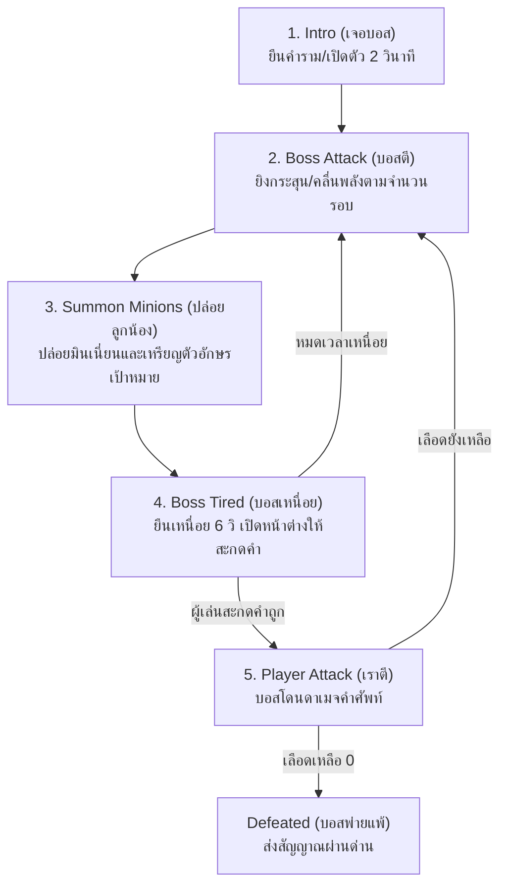

# 🦁 BossController.cs

## 📌 บทสรุปสั้น (Summary)
สคริปต์ควบคุม AI และ State Machine ของบอสประจำด่านธีมสัตว์ ทำหน้าที่ขับเคลื่อน **Boss Game Loop 5 ขั้นตอน** ยิงการโจมตีใส่ผู้เล่น ปล่อยลูกน้องพร้อมคำศัพท์สัตว์ สลับเข้าสู่สถานะเหนื่อย (Tired) เพื่อเปิดโอกาสให้ผู้เล่นพิมพ์สะกดคำ และรับความเสียหายจนบอสพ่ายแพ้

---

## 🔁 วงจรชีวิตการต่อสู้ของบอส (Boss Loop 5 ขั้นตอน)

บอสจะทำงานผ่าน Coroutine `BossLoopCoroutine()` ตาม 5 ขั้นตอนดังนี้:

---

## ⚙️ คุณสมบัติหลัก (Key Features)

1. **Boss State Machine:**
   - ใช้ Enum `BossState`: `Intro`, `BossAttack`, `SummonMinions`, `BossTired`, `Defeated`
   - มีการส่งสัญญาณ Event `OnBossStateChanged` ในทุกครั้งที่มีการเปลี่ยนสถานะ
2. **Animal Vocabulary (ฐานข้อมูลคำศัพท์สัตว์ประจำด่าน):**
   - มีโครงสร้างข้อมูล `AnimalWordData` ประกอบด้วย `word` (คำศัพท์ภาษาอังกฤษ เช่น `"LION"`, `"BEAR"`) และ `meaning` (ความหมายภาษาไทย เช่น `"สิงโต"`, `"หมี"`)
   - รองรับรายการคำศัพท์หลายคำในลิสต์ `targetWords` โดยจะเลื่อนลำดับคำศัพท์ไปเรื่อยๆ เมื่อผู้เล่นสะกดโจมตีสำเร็จ
3. **Boss Attack Action:**
   - ฟังก์ชัน `PerformAttack()` จะ Instantiate กระสุนหรือคลื่นพลัง (`projectilePrefab`) จากตำแหน่ง `attackSpawnPoint` เพื่อให้ผู้เล่นต้องกระโดดหรือสไลด์หลบระหว่างสู้บอส
4. **Damage & Health Check:**
   - ฟังก์ชัน `TakeWordDamage()` จะลดเลือดบอสลงทีละ `damagePerWord` (เช่น ลดครั้งละ 34 จาก 100 หน่วย แปลว่าสะกดคำถูก 3 คำ บอสจะตาย)
   - เมื่อเลือดเหลือ `<= 0` จะหยุด Coroutine ทั้งหมด เปลี่ยนสถานะเป็น `Defeated` และส่ง Event `OnBossDefeated` เพื่อแจ้งให้ `GameManager` ข้ามไปด่านใหม่

---

## 📋 ตัวแปรใน Inspector (Inspector Settings)

| ตัวแปร | ชนิดข้อมูล | ค่าเริ่มต้น | คำอธิบาย |
| :--- | :--- | :--- | :--- |
| `bossName` | `string` | `"LEO THE LION"` | ชื่อของบอสประจำด่าน |
| `maxHealth` | `int` | `100` | พลังชีวิตสูงสุดของบอส |
| `currentHealth` | `int` | `100` | พลังชีวิตปัจจุบันของบอส |
| `damagePerWord` | `int` | `34` | ปริมาณความเสียหายที่บอสจะได้รับต่อการสะกดคำถูก 1 คำ |
| `targetWords` | `List<AnimalWordData>` | - | รายการคำศัพท์สัตว์ประจำด่านนี้ |
| `projectilePrefab` | `GameObject` | - | Prefab กระสุนคลื่นพลังที่บอสยิงโจมตี |
| `attackSpawnPoint` | `Transform` | - | ตำแหน่งจุดยิงกระสุนของบอส |
| `attackInterval` | `float` | `1.2` | ระยะห่างเวลาระหว่างการโจมตีแต่ละนัด (วินาที) |
| `attackCountPerPhase` | `int` | `3` | จำนวนครั้งที่บอสโจมตีต่อ 1 เฟส |
| `tiredDuration` | `float` | `6.0` | ระยะเวลาที่บอสเหนื่อยเพื่อให้ผู้เล่นพิมพ์สะกดคำ (วินาที) |

---

## 📡 Events & Delegation

- `public event Action<BossState> OnBossStateChanged;` : แจ้งเตือนสถานะปัจจุบันของบอส
- `public event Action<int, int> OnBossHealthChanged;` : แจ้งเตือนเลือดบอส `(currentHealth, maxHealth)` เพื่ออัปเดตแถบเลือดบอสบนหน้าจอ
- `public event Action<AnimalWordData> OnPromptWordToPlayer;` : ส่งคำศัพท์และคำแปลที่ต้องพิมพ์ไปยังหน้าต่างพิมพ์คำศัพท์
- `public event Action OnBossDefeated;` : ส่งสัญญาณเมื่อบอสตายเพื่อให้เกมเปลี่ยนด่าน
