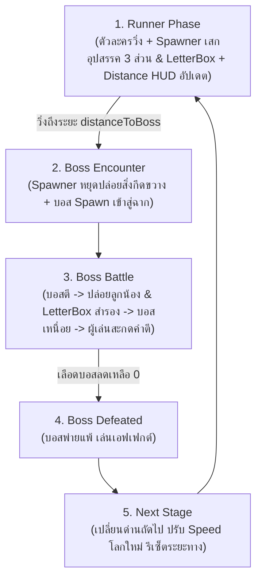
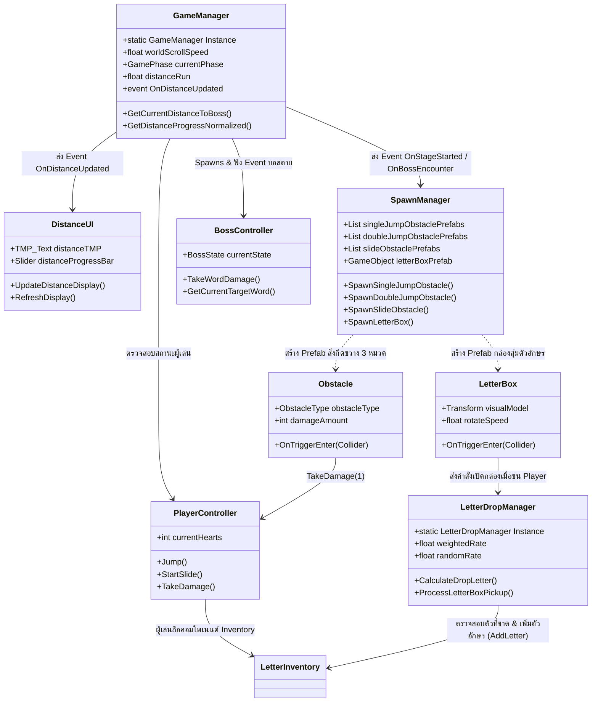

# 📖 Unity Scripts Documentation (สรุปภาพรวมโค้ดทั้งหมด)

เอกสารสรุปสถาปัตยกรรมและการทำงานของสคริปต์ C# ทั้งหมดในโปรเจกต์เกมแนว **Cookie Run Runner + Boss Animal Typing Combat** พร้อมระบบ **Generic Letter Box, Smart Drop System, และ Distance HUD System**

---

## 🎮 1. ภาพรวมของระบบเกม (System Overview)

เกมนี้เป็นการผสมผสานระหว่าง **Stationary Endless Runner (สไตล์ Cookie Run ที่ตัวละครวิ่งอยู่กับที่ โดยฉากเลื่อนเข้าหาตัวละคร)** และ **เกมสะกดคำต่อสู้บอสสัตว์ (Animal Vocabulary Typing Combat)** โดยแบ่งเป็น 2 ช่วงหลักในแต่ละด่าน:
1. **ช่วงวิ่ง (Runner Phase):** 
   - ตัวละครผู้เล่นอยู่กับที่บนแกน X ฉาก แผ่นพื้น สิ่งกีดขวาง และกล่องสุ่มตัวอักษรจะเลื่อนจากขวาไปซ้ายด้วย `ScrollLeft`
   - **`DistanceUI`**: เชื่อมต่อกับ `GameManager` แสดงระยะทางวิ่งแบบ Realtime (`Distance : 0`) พร้อมแสดงหลอดความคืบหน้ามุ่งสู่จุดพบบอส (`distanceToBoss`)
   - **`SpawnManager`**: สุ่มปล่อยวัตถุจาก Prefab โดยแบ่งออกเป็น **3 หมวดการควบคุมชัดเจน**:
     - **1. กระโดด 1 ครั้ง (Single Jump):** สิ่งกีดขวางระดับพื้นเตี้ย (หินเล็ก, ตอไม้) กระโดดครั้งเดียวพ้น
     - **2. กระโดด 2 ครั้ง (Double Jump):** สิ่งกีดขวางระดับพื้นสูง/กว้าง (เสาหิน, กล่องซ้อน) ต้องใช้ Double Jump
     - **3. สไลด์ (Slide / Duck):** สิ่งกีดขวางลอยฟ้า (คานไม้, ผลึกย้อย) ต้องกดย่อตัวสไลด์มุดลอด
     - *(มีระบบ Procedural Prototype Generator สร้างโมเดลจำลองอัตโนมัติหากยังไม่มี Prefab ให้ทดสอบได้ทันที)*
   - **ระบบกล่องสุ่มตัวอักษร (`LetterBox` & `LetterDropManager`):** ป้องกัน Softlock ด้วย Smart Drop สุ่มตัวอักษรที่ขาด (70%) หรือสุ่ม A–Z ทั่วไป (30%) พร้อมเสก Pop-up UI Floating Text (`"+A"`)
2. **ช่วงสู้บอส (Boss Battle Phase):** 
   - เมื่อวิ่งถึงระยะทาง `distanceToBoss` (เช่น 1500 เมตร) ระบบจะหยุดปล่อยสิ่งกีดขวาง และสปอว์นบอสลงมา
   - ผู้เล่นต้องหลบการโจมตี รอจังหวะบอสเหนื่อย แล้วใช้ตัวอักษรในกระเป๋า (`LetterInventory`) พิมพ์สะกดคำภาษาอังกฤษเพื่อทำดาเมจใส่บอสจนเลือดหมด

---

## 🔄 2. Core Game Loop Diagram



---

## 🎁 3. โครงสร้างการทำงานของระบบสุ่มตัวอักษร (Letter Box & Smart Drop Workflow)

```
[SpawnManager] ──เสก──> [LetterBox Prefab] (เลื่อนซ้ายตามฉากด้วย ScrollLeft)
                              │
                    (ผู้เล่นวิ่งชน Trigger)
                              │
                              ▼
                [LetterDropManager (Smart Drop)]
                              │ คำนวณสุ่มตัวอักษรเบื้องหลัง
                    ┌─────────┴─────────┐
                    ▼                   ▼
          Weighted Rate (70%)    Random Rate (30%)
          [สุ่มตัวอักษรที่ยังขาด]   [สุ่มตัวอักษรทั่วไป A-Z]
                    │                   │
                    └─────────┬─────────┘
                              ▼
         ├── 1. ส่งตัวอักษรเข้า LetterInventory
         ├── 2. เล่น Pop-up UI Floating Text ("+A")
         └── 3. ทำลาย/ปิดการใช้งาน กล่อง
```

---

## 📂 4. รายชื่อสคริปต์และสรุปหน้าที่ (Script Index)

| ชื่อสคริปต์ (Script Name) | เอกสารสรุป (.md) | หน้าที่หลัก (Core Responsibility) |
| :--- | :--- | :--- |
| **`DistanceUI.cs`** | [`DistanceUI.md`](DistanceUI.md) | **[ใหม่]** แสดงผลระยะทางบนหน้าจอ HUD (`Distance : 0`) เชื่อมต่อกับ GameManager แบบ Realtime รองรับทั้ง TMP, UI Text, และ Progress Slider |
| **`PlayerController.cs`** | [`PlayerController.md`](PlayerController.md) | ฟิสิกส์การกระโดดสไตล์ Cookie Run (Fast Fall ตกแตะพื้นไว ไม่ลอยเคว้ง), Double Jump พุ่งทันใจ, ท่าสไลด์กลางอากาศดิ่งลงพื้น, Jump Buffer & Coyote Time, และระบบตกเหว |
| **`ScrollLeft.cs`** | [`ScrollLeft.md`](ScrollLeft.md) | ขับเคลื่อนวัตถุจากขวาไปซ้าย โดยแยกความเร็วระหว่างวัตถุเกมเพลย์ (`GameplayObject`) กับฉากหลัง (`WorldBackground`) ออกจากกันอย่างอิสระ |
| **`SpawnManager.cs`** | [`SpawnManager.md`](SpawnManager.md) | เสกของจาก Prefab 3 หมวด (กระโดด 1 ครั้ง, กระโดด 2 ครั้ง, สไลด์) + กล่องสุ่ม โดยแยกจุดปล่อยบนพื้นสำหรับกล่องสุ่มไม่ให้จมดิน |
| **`Obstacle.cs`** | [`Obstacle.md`](Obstacle.md) | ระบุประเภทสิ่งกีดขวาง 3 หมวด (SingleJump, DoubleJump, Slide) แสดง Gizmo สี และสร้างดาเมจลดเลือดผู้เล่นเมื่อชน |
| **`LetterBox.cs`** | [`LetterBox.md`](LetterBox.md) | กล่องสุ่ม/ถุงวัตถุดิบ 3D (Single Prefab) หมุนและลอยกระเพื่อม เลื่อนด้วย `ScrollLeft` และส่งสัญญาณเปิดกล่องเมื่อชนผู้เล่น |
| **`LetterDropManager.cs`** | [`LetterDropManager.md`](LetterDropManager.md) | สมองคำนวณ Smart Drop เบื้องหลัง สุ่มแบบถ่วงน้ำหนัก 70% ตัวที่ขาด / 30% สุ่ม A-Z ส่งตัวเข้ากระเป๋าและเสก Floating Text |
| **`FloatingText.cs`** | [`FloatingText.md`](FloatingText.md) | ข้อความ Pop-up ลอยบนโลก 3D แสดง `"+A"` ลอยขึ้น เด้งขยาย และค่อยๆ จางหายไป (Fade Out) |
| **`LetterInventory.cs`** | [`LetterInventory.md`](LetterInventory.md) | คลังจัดเก็บตัวอักษร (Dictionary) พร้อมฟังก์ชันตรวจสอบตัวที่ขาด (`GetLetterCount`), ตรวจสอบความพร้อมสะกดคำ และหักตัวอักษร |
| **`CollectibleLetter.cs`** | [`CollectibleLetter.md`](CollectibleLetter.md) | เหรียญ/ตัวอักษร 3D รายตัวแบบเดิม (ใช้เป็นตัวเลือกหรือระบบเสริม) หมุนและลอยขึ้นลงด้วย `ScrollLeft` |
| **`BossController.cs`** | [`BossController.md`](BossController.md) | จัดการลูปบอส 5 ขั้นตอน (เจอบอส -> บอสตี -> ปล่อยลูกน้อง+กล่อง -> บอสเหนื่อย -> เราตี), หลอดเลือดบอส และคำศัพท์ประจำด่าน |
| **`BossTypingCombat.cs`** | [`BossTypingCombat.md`](BossTypingCombat.md) | ควบคุมหน้าต่าง UI สำหรับพิมพ์คำศัพท์ (TextMeshPro InputField), ตรวจสอบความถูกต้อง และส่งคำสั่งโจมตีบอส |
| **`GameManager.cs`** | [`GameManager.md`](GameManager.md) | ควบคุมเกมรวมแบบ Singleton, ซิงค์ความเร็วของด่าน, คำนวณระยะทาง `distanceRun`, สปอว์นบอส และโหลดด่านถัดไป |

---

## 🔗 5. ความสัมพันธ์ระหว่างสคริปต์ (Component Relationships)


