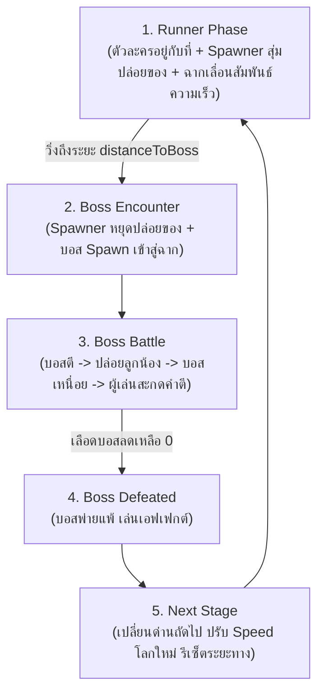
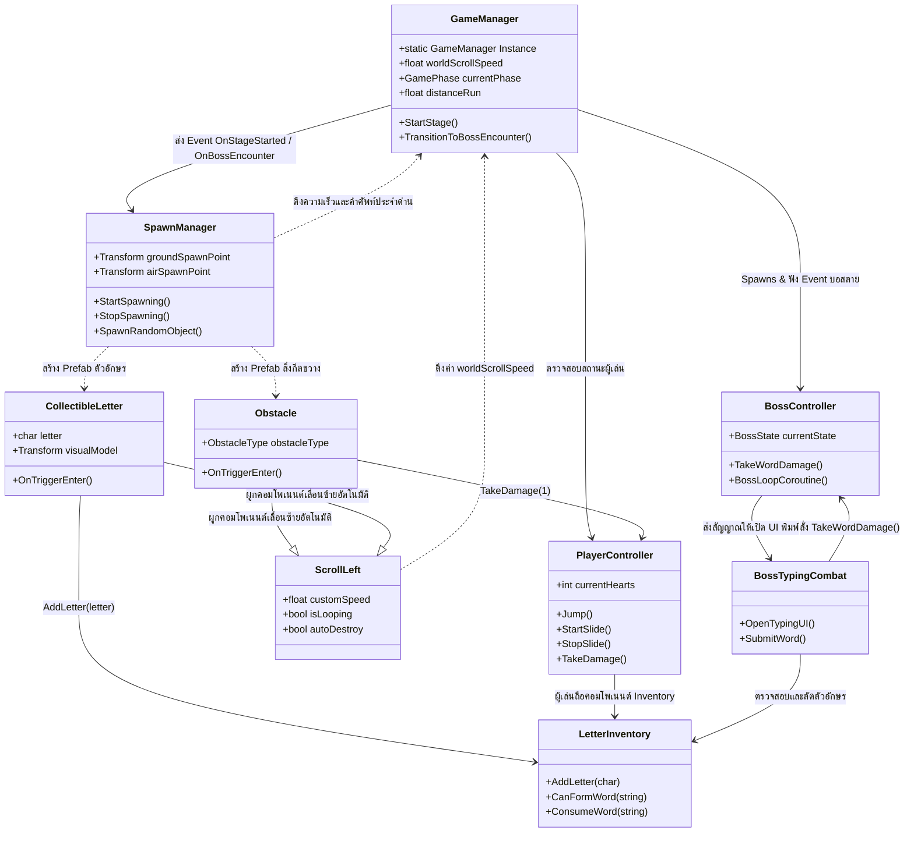

# 📖 Unity Scripts Documentation (สรุปภาพรวมโค้ดทั้งหมด)

เอกสารสรุปสถาปัตยกรรมและการทำงานของสคริปต์ C# ทั้งหมดในโปรเจกต์เกมแนว **Cookie Run Runner + Boss Animal Typing Combat**

---

## 🎮 1. ภาพรวมของระบบเกม (System Overview)

เกมนี้เป็นการผสมผสานระหว่าง **Stationary Endless Runner (สไตล์ Cookie Run ที่ตัวละครวิ่งอยู่กับที่ โดยฉากเลื่อนเข้าหาตัวละคร)** และ **เกมสะกดคำต่อสู้บอสสัตว์ (Animal Vocabulary Typing Combat)** โดยแบ่งเป็น 2 ช่วงหลักในแต่ละด่าน:
1. **ช่วงวิ่ง (Runner Phase):** 
   - ตัวละครผู้เล่นอยู่กับที่บนแกน X ฉาก แผ่นพื้น สิ่งกีดขวาง และเหรียญตัวอักษรจะเลื่อนจากขวาไปซ้ายด้วย `ScrollLeft`
   - **`SpawnManager`** จะสุ่มปล่อยสิ่งกีดขวาง (Low/High) และเหรียญตัวอักษร 3D ออกมาจากจุดที่กำหนดทางขวา โดยปรับความถี่ในการปล่อยให้สัมพันธ์กับความเร็วของด่าน (`worldScrollSpeed`) อัตโนมัติ
   - ผู้เล่นต้องกระโดด 2 จังหวะข้ามสิ่งกีดขวางต่ำ หรือกดย่อตัวสไลด์แนบพื้นลอดสิ่งกีดขวางสูง พร้อมทั้งเก็บ **เหรียญ/โมเดลตัวอักษร 3D (Collectible Letters)** ที่สุ่มมาจากคำศัพท์เป้าหมายเข้ากระเป๋า (Letter Inventory)
2. **ช่วงสู้บอส (Boss Battle Phase):** 
   - เมื่อระยะทางที่ฉากเลื่อนวิ่งถึงที่กำหนด `SpawnManager` จะหยุดปล่อยสิ่งกีดขวาง และบอสประจำด่านจะสปอว์นลงมา
   - ผู้เล่นต้องหลบการโจมตีของบอส รอจังหวะบอสเหนื่อย แล้วใช้ตัวอักษรภาษาอังกฤษที่มีในกระเป๋ามาพิมพ์สะกดคำศัพท์ภาษาอังกฤษผ่านหน้าต่าง UI เพื่อโจมตีบอสจนเลือดหมด แล้วผ่านไปด่านถัดไปที่มีความเร็วสูงขึ้น

---

## 🔄 2. Core Game Loop Diagram

---

## 📂 3. รายชื่อสคริปต์และสรุปหน้าที่ (Script Index)

| ชื่อสคริปต์ (Script Name) | เอกสารสรุป (.md) | หน้าที่หลัก (Core Responsibility) |
| :--- | :--- | :--- |
| **`PlayerController.cs`** | [`PlayerController.md`](PlayerController.md) | วิ่งอยู่กับที่ (X=0), กระโดด 2 ชั้น (Double Jump), กดย่อตัวสไลด์แนบพื้น (Hold-to-Duck), ระบบเลือด 3 หัวใจ และอมตะชั่วขณะ (I-Frames) |
| **`ScrollLeft.cs`** | [`ScrollLeft.md`](ScrollLeft.md) | ขับเคลื่อนวัตถุ (ฉาก, พื้น, สิ่งกีดขวาง, ตัวอักษร) จากขวาไปซ้าย, ทำลายอัตโนมัติเมื่อพ้นจอ, และวาร์ปวนลูปแผ่นพื้นไม่สิ้นสุด (Infinite Looping) |
| **`SpawnManager.cs`** | [`SpawnManager.md`](SpawnManager.md) | สุ่มปล่อยสิ่งกีดขวางและตัวอักษร 3D จากจุดปล่อยทางขวา ปรับความถี่สัมพันธ์กับความเร็วด่าน และสุ่มตัวอักษรจากคำศัพท์เป้าหมาย |
| **`Obstacle.cs`** | [`Obstacle.md`](Obstacle.md) | จัดการสิ่งกีดขวาง แบ่งประเภทเป็น Low (กระโดดข้าม) และ High (สไลด์มุดลอด) เลื่อนด้วย `ScrollLeft` และลดเลือดผู้เล่นเมื่อชน |
| **`CollectibleLetter.cs`** | [`CollectibleLetter.md`](CollectibleLetter.md) | จัดการเหรียญและโมเดลตัวอักษร 3D หมุนและลอยขึ้นลง (Bobbing Effect) เลื่อนด้วย `ScrollLeft` และส่งตัวอักษรเข้ากระเป๋าเมื่อชน |
| **`LetterInventory.cs`** | [`LetterInventory.md`](LetterInventory.md) | คลังจัดเก็บตัวอักษร (Dictionary) ตรวจสอบว่ามีตัวอักษรพอสะกดคำศัพท์เป้าหมายหรือไม่ และหักตัวอักษรออกเมื่อโจมตีบอส |
| **`BossController.cs`** | [`BossController.md`](BossController.md) | จัดการลูปบอส 5 ขั้นตอน (เจอบอส -> บอสตี -> ปล่อยลูกน้อง -> บอสเหนื่อย -> เราตี), หลอดเลือดบอส และคำศัพท์ประจำด่าน |
| **`BossTypingCombat.cs`** | [`BossTypingCombat.md`](BossTypingCombat.md) | ควบคุมหน้าต่าง UI สำหรับพิมพ์คำศัพท์ (TextMeshPro InputField), ตรวจสอบความถูกต้อง และส่งคำสั่งโจมตีบอส |
| **`GameManager.cs`** | [`GameManager.md`](GameManager.md) | ควบคุมเกมรวมแบบ Singleton, จัดการความเร็วของแต่ละด่าน (`stageSpeed`), คำนวณระยะทาง, สปอว์นบอส และโหลดด่านถัดไป |

---

## 🔗 4. ความสัมพันธ์ระหว่างสคริปต์ (Component Relationships)

