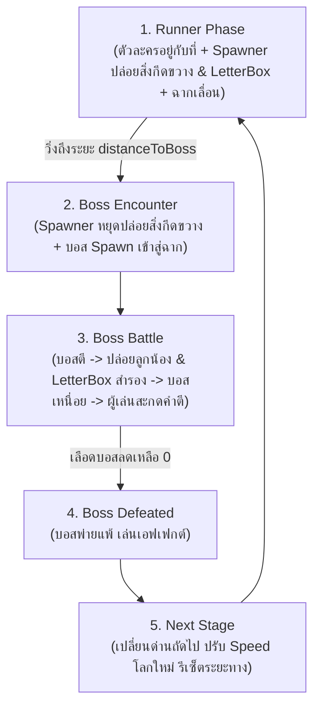
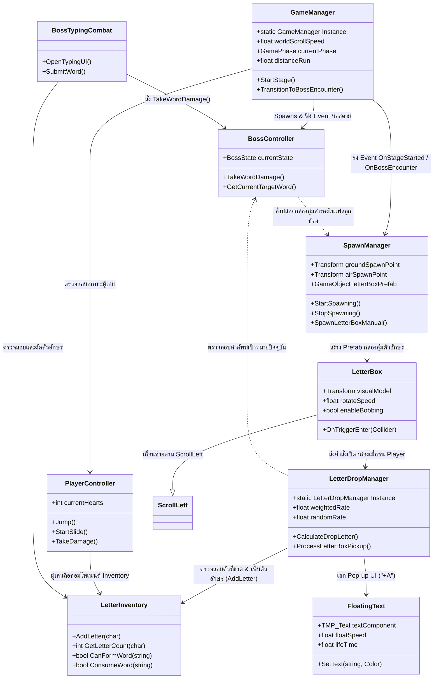

# 📖 Unity Scripts Documentation (สรุปภาพรวมโค้ดทั้งหมด)

เอกสารสรุปสถาปัตยกรรมและการทำงานของสคริปต์ C# ทั้งหมดในโปรเจกต์เกมแนว **Cookie Run Runner + Boss Animal Typing Combat** พร้อมระบบ **Generic Letter Box & Smart Drop System**

---

## 🎮 1. ภาพรวมของระบบเกม (System Overview)

เกมนี้เป็นการผสมผสานระหว่าง **Stationary Endless Runner (สไตล์ Cookie Run ที่ตัวละครวิ่งอยู่กับที่ โดยฉากเลื่อนเข้าหาตัวละคร)** และ **เกมสะกดคำต่อสู้บอสสัตว์ (Animal Vocabulary Typing Combat)** โดยแบ่งเป็น 2 ช่วงหลักในแต่ละด่าน:
1. **ช่วงวิ่ง (Runner Phase):** 
   - ตัวละครผู้เล่นอยู่กับที่บนแกน X ฉาก แผ่นพื้น สิ่งกีดขวาง และกล่องสุ่มตัวอักษรจะเลื่อนจากขวาไปซ้ายด้วย `ScrollLeft`
   - **`SpawnManager`** จะสุ่มปล่อยสิ่งกีดขวาง (Low/High) และ **กล่องสุ่มตัวอักษร 3D (`LetterBox`)** ออกมาจากจุดที่กำหนดทางขวา โดยปรับความถี่ในการปล่อยให้สัมพันธ์กับความเร็วของด่าน (`worldScrollSpeed`) อัตโนมัติ
   - **ระบบกล่องสุ่ม/ถุงวัตถุดิบ (Generic Letter Box):** ใช้ Prefab 3D โมเดลเดียว (เช่น กล่องสมบัติ, ถุงผ้า, ผลึกอัญมณี) แทนการสร้างโมเดลตัวอักษร 26 ตัว ช่วยแก้ปัญหาเรื่อง Asset ได้เด็ดขาด
   - **ระบบ Smart Drop System เบื้องหลัง (`LetterDropManager`):** ป้องกันปัญหา Softlock (ขาดตัวอักษรตอนสู้บอส) อย่างแนบเนียน โดยแบ่งน้ำหนักการสุ่มเป็น **Weighted Rate (70%)** ดึงเฉพาะตัวอักษรที่ผู้เล่นยังขาดอยู่สำหรับคำศัพท์บอส และ **Random Rate (30%)** สุ่มตัวอักษรทั่วไป A–Z
   - ผู้เล่นต้องกระโดด 2 จังหวะข้ามสิ่งกีดขวางต่ำ หรือกดย่อตัวสไลด์แนบพื้นลอดสิ่งกีดขวางสูง พร้อมทั้งวิ่งเก็บกล่องสุ่มตัวอักษร ซึ่งจะแสดงผลเป็น **Pop-up UI Floating Text (`"+A"`)** ลอยขึ้นและส่งตัวอักษรเข้ากระเป๋า (`LetterInventory`)
2. **ช่วงสู้บอส (Boss Battle Phase):** 
   - เมื่อระยะทางที่ฉากเลื่อนวิ่งถึงที่กำหนด `SpawnManager` จะหยุดปล่อยสิ่งกีดขวาง และบอสประจำด่านจะสปอว์นลงมา
   - ผู้เล่นต้องหลบการโจมตีของบอส รอจังหวะบอสเหนื่อย แล้วใช้ตัวอักษรภาษาอังกฤษที่มีในกระเป๋ามาพิมพ์สะกดคำศัพท์ภาษาอังกฤษผ่านหน้าต่าง UI เพื่อโจมตีบอสจนเลือดหมด แล้วผ่านไปด่านถัดไปที่มีความเร็วสูงขึ้น

---

## 🔄 2. Core Game Loop Diagram



---

## 🎁 3. โครงสร้างการทำงานของระบบสุ่มตัวอักษร (Letter Box & Smart Drop Workflow)

```
[SpawnManager] ──เสก──> [LetterBox Prefab] (เลื่อนซ้ายตามฉากด้วย ScrollLeft)
                              │
                    (ผู้เล่นวิ่งชน Trigger)
                              │
                              ▼
                [LetterDropManager (Smart Drop)]
                              │ คำนวณสุ่มตัวอักษรเบื้องหลัง
                    ┌─────────┴─────────┐
                    ▼                   ▼
          Weighted Rate (70%)    Random Rate (30%)
          [สุ่มตัวอักษรที่ยังขาด]   [สุ่มตัวอักษรทั่วไป A-Z]
                    │                   │
                    └─────────┬─────────┘
                              ▼
         ├── 1. ส่งตัวอักษรเข้า LetterInventory
         ├── 2. เล่น Pop-up UI Floating Text ("+A")
         └── 3. ทำลาย/ปิดการใช้งาน กล่อง
```

---

## 📂 4. รายชื่อสคริปต์และสรุปหน้าที่ (Script Index)

| ชื่อสคริปต์ (Script Name) | เอกสารสรุป (.md) | หน้าที่หลัก (Core Responsibility) |
| :--- | :--- | :--- |
| **`PlayerController.cs`** | [`PlayerController.md`](PlayerController.md) | วิ่งอยู่กับที่ (X=0), กระโดด 2 ชั้น (Double Jump), กดย่อตัวสไลด์แนบพื้น (Hold-to-Duck), ระบบเลือด 3 หัวใจ และอมตะชั่วขณะ (I-Frames) |
| **`ScrollLeft.cs`** | [`ScrollLeft.md`](ScrollLeft.md) | ขับเคลื่อนวัตถุ (ฉาก, พื้น, สิ่งกีดขวาง, กล่องสุ่ม) จากขวาไปซ้าย, ทำลายอัตโนมัติเมื่อพ้นจอ, และวาร์ปวนลูปแผ่นพื้นไม่สิ้นสุด |
| **`SpawnManager.cs`** | [`SpawnManager.md`](SpawnManager.md) | สุ่มปล่อยสิ่งกีดขวางและกล่องสุ่ม `LetterBox` จากจุดปล่อยทางขวา ปรับความถี่สัมพันธ์กับความเร็วด่าน และมีฟังก์ชันปล่อยของฉุกเฉินตอนสู้บอส |
| **`LetterBox.cs`** | [`LetterBox.md`](LetterBox.md) | **[ใหม่]** กล่องสุ่ม/ถุงวัตถุดิบ 3D (Single Prefab) หมุนและลอยกระเพื่อม เลื่อนด้วย `ScrollLeft` และส่งสัญญาณเปิดกล่องเมื่อชนผู้เล่น |
| **`LetterDropManager.cs`** | [`LetterDropManager.md`](LetterDropManager.md) | **[ใหม่]** สมองคำนวณ Smart Drop เบื้องหลัง สุ่มแบบถ่วงน้ำหนัก 70% ตัวที่ขาด / 30% สุ่ม A-Z ส่งตัวเข้ากระเป๋าและเสก Floating Text |
| **`FloatingText.cs`** | [`FloatingText.md`](FloatingText.md) | **[ใหม่]** ข้อความ Pop-up ลอยบนโลก 3D แสดง `"+A"` ลอยขึ้น เด้งขยาย และค่อยๆ จางหายไป (Fade Out) |
| **`LetterInventory.cs`** | [`LetterInventory.md`](LetterInventory.md) | คลังจัดเก็บตัวอักษร (Dictionary) พร้อมฟังก์ชันตรวจสอบตัวที่ขาด (`GetLetterCount`), ตรวจสอบความพร้อมสะกดคำ และหักตัวอักษร |
| **`Obstacle.cs`** | [`Obstacle.md`](Obstacle.md) | จัดการสิ่งกีดขวาง แบ่งประเภทเป็น Low (กระโดดข้าม) และ High (สไลด์มุดลอด) เลื่อนด้วย `ScrollLeft` และลดเลือดผู้เล่นเมื่อชน |
| **`CollectibleLetter.cs`** | [`CollectibleLetter.md`](CollectibleLetter.md) | เหรียญ/ตัวอักษร 3D รายตัวแบบเดิม (ใช้เป็นตัวเลือกหรือระบบเสริม) หมุนและลอยขึ้นลงด้วย `ScrollLeft` |
| **`BossController.cs`** | [`BossController.md`](BossController.md) | จัดการลูปบอส 5 ขั้นตอน (เจอบอส -> บอสตี -> ปล่อยลูกน้อง+กล่อง -> บอสเหนื่อย -> เราตี), หลอดเลือดบอส และคำศัพท์ประจำด่าน |
| **`BossTypingCombat.cs`** | [`BossTypingCombat.md`](BossTypingCombat.md) | ควบคุมหน้าต่าง UI สำหรับพิมพ์คำศัพท์ (TextMeshPro InputField), ตรวจสอบความถูกต้อง และส่งคำสั่งโจมตีบอส |
| **`GameManager.cs`** | [`GameManager.md`](GameManager.md) | ควบคุมเกมรวมแบบ Singleton, จัดการความเร็วของแต่ละด่าน (`stageSpeed`), คำนวณระยะทาง, สปอว์นบอส และโหลดด่านถัดไป |

---

## 🔗 5. ความสัมพันธ์ระหว่างสคริปต์ (Component Relationships)


